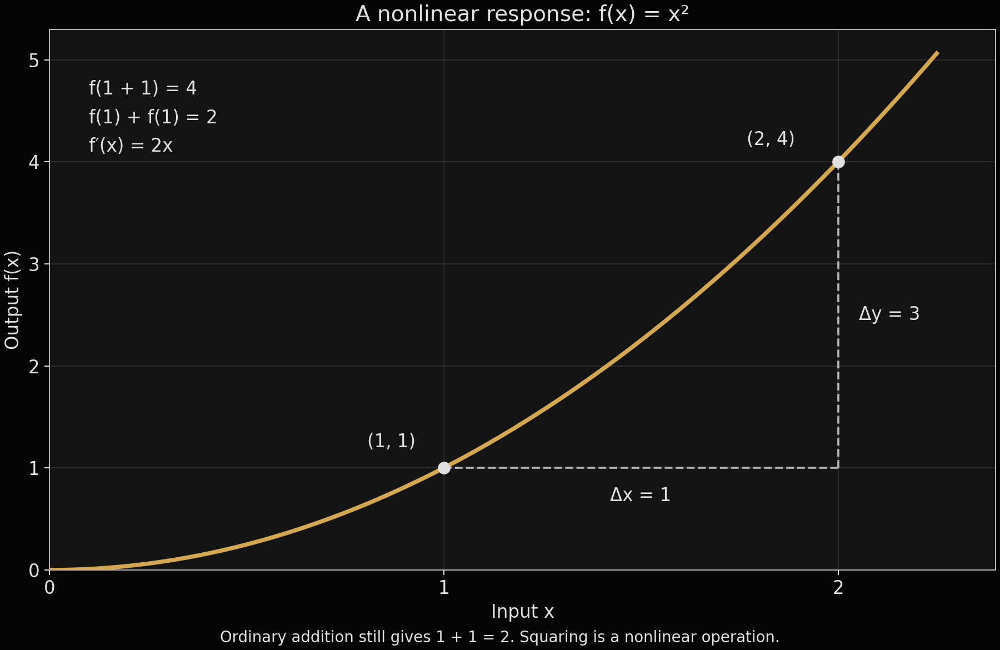

# Fifteen Minutes at the Threshold

*A reading circle for people making a world together.*

There is a book beside the unfinished work. A question in the margin. Something you cannot quite explain yet, but keep returning to because it changes the way you see what you are making.

That belongs here.

The Threshold is our invitation to read for fifteen minutes a day, then make room for whatever the reading brings up. A question. An objection. A connection between a character’s choice and a system we are building. You can begin before you know how to write a line of code.

Gods of Mayhem began as a competitive gaming team in 2013. Today it is Loptr Lab’s competitive division and a community participation pathway. Within our creative work, Veiled Dominion is an asymmetric four-player strategy game under development: a world where Rebirth begins dangerously powerful, and mastery means learning restraint. Death’s protection and Rebirth’s consequences make boundaries part of the design.

That question reaches beyond the board. What does power do to the people around it? What does a system reward? Who gets to explain what happened?

In [Designing Restraint](https://pixie.pckt.blog/designing-restraint-how-we-build-games-to-process-loss-43f7a1t), story and mechanics already meet through that tension. The Threshold gives us a small, repeatable way to keep examining it as we write, draw, test and develop. The current game rules remain in their owning sources; the blog records a developing practice.

The practice can fit beside the rest of a life. Fifteen minutes with a library book before the day starts. An audiobook on a journey. A chapter spread across several evenings. Continue from where you stopped. There is no streak to protect and no obligation to finish a novel in a week.

Start at your local public library. Ask about interlibrary loans, ebooks, audiobooks and accessible editions. [Open Library](https://openlibrary.org/) can help you find editions too; its catalogue does not promise that every title is available to borrow. Try a resale bookstore, a library sale or a book exchange before buying new. An independent bookshop can help find an edition. Amazon can wait. Your place here does not depend on a purchase.

Our starting shelf holds seven books:

- **Altered Carbon — Richard K. Morgan:** IVXX and the question of identity when a signal home is compromised.
- **Ancillary Justice — Ann Leckie:** distributed identity, power and the decision to exercise restraint.
- **Annihilation — Jeff VanderMeer:** the Veil and the limits of what a person can know from inside an experience.
- **The Left Hand of Darkness — Ursula K. Le Guin:** myth doing work inside a community, shaping trust and obligation.
- **Children of Time — Adrian Tchaikovsky:** intelligence and power that take unfamiliar forms.
- **Rules of Play — Katie Salen and Eric Zimmerman:** the language of feedback, win conditions and asymmetric balance.
- **The Art of Game Design — Jesse Schell:** examining choices, consequences and the systems around them.

These are points of conversation. The next step might be an original IVXX scene, two accounts of a Veiled encounter, an art study or a question to take into a playtest. We name our influences and keep new work marked as proposed until it has been reviewed.

Visual reading belongs alongside the books. *The Department of Truth* #16 informs the art. Its place in this process is already recorded in [Reversing the Feed](https://pixie.pckt.blog/pixie-reversing-the-feed-hbqst4e), where music, poetry, imagery and uncertainty meet. We can study a visual choice, identify what it does for us, and make an original response without pretending that our interpretation belongs to its creators.

When I talk about the Zen of programming, I mean a lifelong practice of attention: returning to the problem, noticing an assumption, accepting that something needs another look. A compiler error can ask for patience. Another person’s question can reveal the part of a design we stopped seeing.

Mathematics is part of development. So are logic, language, critical thinking and the ability to hear an answer we did not expect. Before adding features, we need to understand what we are counting, what an operation means and whether the result serves the person using it.

“One plus one doesn’t always equal two” can be a useful provocation if we make the context explicit. In ordinary arithmetic, 1 + 1 = 2. In Boolean logic, 1 OR 1 = 1: we are combining truth values using a different operation. A developer has to notice that difference.

Calculus offers another way to examine the assumption that effects simply add. For f(x) = x², f(1 + 1) = 4, while f(1) + f(1) = 2. Its derivative is f′(x) = 2x: the rate of change depends on where we are. Increasing x from 1 to 2 increases the output from 1 to 4. The input grew by one; the output grew by three. [OpenStax explains the power rule](https://openstax.org/books/calculus-volume-1/pages/3-3-differentiation-rules).

That graph describes a mathematical function. Using it to think about a creative system is an analogy we can question: what changes when two features interact, when a rule meets another rule, when a story is heard from another position? We still have to observe, test and explain the actual result.

Reading gives us practice at that work. After your fifteen minutes, try writing a few sentences around one question:

- What happened, or what claim did the author make? Can I explain it in my own words?
- Which detail supports my interpretation? Where is it in my edition?
- What remains unclear? What would I ask another reader?
- What other explanation could fit? What evidence would change my mind?
- Which part of our project does this illuminate, and where does the comparison stop working?

You can keep the response private. You can bring a question instead of an answer. Writing can help us discover what we understand and what we have only assumed. A sketch, a spoken thought or listening to the discussion can also be a way in.

[What Can an Artist Leave Behind?](https://pixie.pckt.blog/what-can-an-artist-leave-behind-jsj8pt6) asks us to keep the person visible alongside the work. A reading circle should make room for the life that person has: caregiving, shifts, different reading speeds, different ways of accessing a book. Participation needs room to breathe.

So choose the place that fits today. Reader. Writer. Artist. Designer. Tester. Someone with a question. If you want company, come through the existing [Made-Sick community entrance](https://made-sick.org/join.html). Bring the book, your reading position and one thought you want to explore; use a spoiler warning when needed. Discussion is opt-in and self-paced. A shared question can become a small contribution, reviewed through the project that owns it.

[Open The Threshold reading list, prompts and optional timer](https://loptr-lab.github.io/training/threshold.html).

Fifteen minutes is enough to begin. Tomorrow, we return with a little more to notice.

*Process note: Drafted with AI from Dominique’s direction, the existing Threshold reading list and the published PIXIE archive. Dominique retains editorial and story-canon decisions. The graph is an original mathematical illustration, not a reproduction of referenced artwork.*
